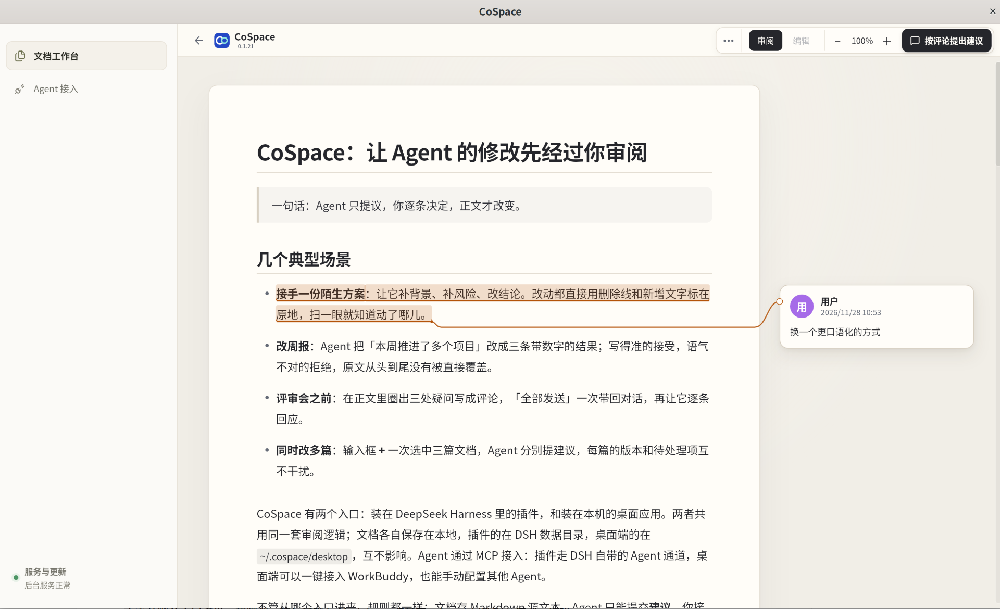

# 智联文档空间（CoSpace）

让 Agent 帮你起草和修改文档，同时由你决定哪些修改真正生效。

[English](README.en.md) | 中文

CoSpace 面向 Agent 与个人文档协作。Agent 可以读取你指定的文档、创建新文档，或对已有内容提出带版本和位置的修改建议。已有文档只有在用户接受建议后才会改变；冲突修改会被拒绝，避免覆盖彼此的工作。

[](assets/preview-desktop.png)

*桌面端：独立窗口里的文档工作台，圈出位置直接留评论，Agent 的修改逐条由你决定。*

## 开始使用

CoSpace 提供两个产品入口，当前可用状态和安装方式见[官网](https://hanfang5057-byte.github.io/co-space/)：

| 入口 | 适用场景 | 安装与状态 |
| --- | --- | --- |
| DSH 插件 | 在 DSH 对话中引用文档并审阅建议 | npm 包 `dsh-plugin-space`；在 DSH 的 Plugins 页面添加，或运行 `dsh plugin add dsh-plugin-space`。当前发布版需要 Node.js 24+、DSH `0.2.3-alpha.2` 及以上。 |
| 桌面端 | 为支持 stdio MCP 的 Agent 提供本地文档工作台 | 已发布：macOS（Apple 芯片）与 Linux（deb/AppImage）安装包见 [Releases](https://github.com/hanfang5057-byte/co-space/releases)；Intel Mac 不受支持。安装与迁移说明见[官网](https://hanfang5057-byte.github.io/co-space/)与[桌面端说明](apps/desktop/README.md)。旧版 Local Server 已停止分发，其数据可在桌面端首次启动时导入。 |

如需从插件市场发现 DSH 插件，可将[市场索引](https://raw.githubusercontent.com/hanfang5057-byte/co-space/main/market/index.json)添加到 DSH 的 Custom plugin indexes。

在 DSH 中，同一套审阅是这样：

[](assets/preview.png)

## 工作方式

CoSpace 将文档保存为 Markdown。Agent 对已有文档提交有版本约束的文本替换建议；你可以逐条接受或拒绝。新文档可以由用户创建空白文档，也可以由 Agent 创建并提供初始正文。评论属于用户上下文，只有在用户明确触发处理后才交给 Agent。

文档和审阅记录保存在本机 SQLite。DSH 插件与桌面端各自使用独立的数据目录。MCP 工具针对指定文档操作，不提供文档枚举。

## 架构

一个共享审阅核心服务于 DSH 插件和桌面端。共享包不依赖具体宿主；适配器和应用通过 host API、能力契约与通用传输层接入。桌面端使用 `local-runtime`，DSH 保持独立运行时和数据边界。

详细边界、新增入口流程和审阅语义见[系统架构](docs/09-host-adapters-architecture.md)、[适配器接入规范](docs/14-adapter-integration.md)和[审阅内核说明](docs/07-review-core.md)。

## 本地开发

开发需要 Node.js 22.22.2 或更高版本；桌面端开发和打包需要 Node.js 24+、Rust 和目标平台构建依赖。

```sh
npm install
npm run test:fast
npm run check
npm run build:dsh
```

`test:fast` 适合日常开发；`check` 运行完整测试，包括本地服务、数据迁移和更新协调测试。

更多构建和发布命令见[统一发布流程](docs/16-release-process.md)。发布包和安装器应从各自的暂存目录构建、验证；根目录 workspace 是私有的，不可直接发布。

## 项目文档

- [DSH 插件说明](adapters/dsh/README.md)
- [桌面端说明](apps/desktop/README.md)
- [产品计划](PLAN.md)
- [许可证](LICENSE)：MIT
