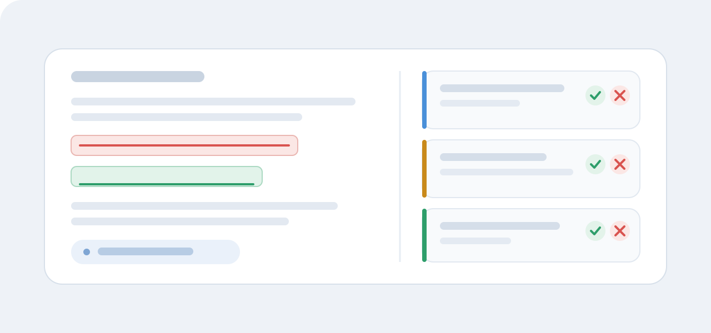

# CoSpace for DSH

Review agent-proposed Markdown edits in DeepSeek Harness: the agent proposes changes, and you accept or reject each suggestion. Comments stay in the document, and the agent reads them only when you ask it to.

## Install

- **DSH Desktop / Web**: open **Plugins**, choose **Add plugin**, enter `dsh-plugin-space`, then enable it. A **CoSpace** entry appears in the sidebar.
- **CLI**: `dsh plugin add dsh-plugin-space`

Requires DSH `^0.2.2-rc.5` and Node.js 24 or later. Offline installs can use the `dsh-plugin-space-<version>.tgz` attached to each [GitHub Release](https://github.com/hanfang5057-byte/co-space/releases).

## Use

- Open **CoSpace** in the sidebar to create a document, read the text, and decide each pending suggestion.
- Use the composer's **+** menu to reference one or more CoSpace documents as `space:<docId>`.
- Select text in a document to leave a comment; **Ask the agent to handle comments** sends only the document reference and a short instruction.

## Data

Documents, suggestions, comments, and comment-handling results are stored locally in `$DSH_HOME/space/review.sqlite`. Set `DSH_SPACE_HOME` to choose another directory. Agent-proposed edits do not change accepted content until the user accepts them. Comment text is not sent in the prompt; the agent reads it through the MCP tools after an explicit user action.

## Links

- [Source and documentation](https://github.com/hanfang5057-byte/co-space)
- [Plugin index](https://hanfang5057-byte.github.io/co-space/market/index.json)
- [Review model and limits](https://github.com/hanfang5057-byte/co-space/tree/main/docs)
- [Security policy](https://github.com/hanfang5057-byte/co-space/blob/main/SECURITY.md)
