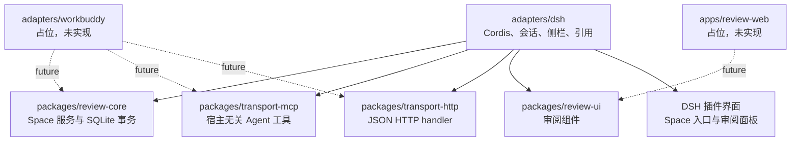

# 09 · CoSpace 多宿主适配器与 WorkBuddy Connector 架构

> 架构基线。2026-11-23，CoSpace 已形成共享 workspace、独立 DSH 与 WorkBuddy adapters。DSH npm 包从暂存目录构建；WorkBuddy Connector 已实现本地 MCP、隔离数据目录、loopback 审阅服务及滑动空闲保活，并完成本机合成数据验收。Connector 市场提审和跨平台真实宿主验收仍未完成。真实 DSH 宿主验收状态以 [04 · DSH 集成契约](04-dsh-integration.md) 为准。

## 目标与约束

### 目标

- 在一个仓库维护文档、建议、冲突、评论和用户决策规则，避免 DSH 与 WorkBuddy 各自复制审阅核心。
- 分别构建 DSH 插件 npm 包和 WorkBuddy Connector 包；两个分发物只携带各自宿主入口及所需的共享核心。
- 为 WorkBuddy 提供本机独立审阅页面，无需原生 App、应用商店上架或云端服务。
- 保持“Agent 提建议，用户决定是否接受”的事实来源与事务行为一致。
- 允许两种宿主具有不同功能，宿主能力差异由适配器边界明确表达。

### 已知约束与设计决定

- 用户已核实：WorkBuddy 个人主体可上传 Connector，但不能开发应用。因此本方案不依赖 WorkBuddy OpenAPI，不要求 OAuth 应用、client secret 或 WorkBuddy 会话 API。
- WorkBuddy 未发现可供本项目使用的插件式 UI 扩展或对话 API。WorkBuddy 中的自然语言任务由 Connector 工具完成；审阅、决策和文档管理由独立本机网页完成。
- WorkBuddy Connector 官方规范支持 MCP + Skill、`stdio` 和托管 Node runtime。第一版采用此分发方式；Connector 市场审核、本机进程生命周期及审阅链接行为仍须实测确认。
- 不开发原生客户端，不要求用户安装 Node.js、手动编辑 MCP 配置、选择 Space 名称或设置本机数据目录。Space 名称固定为“Space”，本机数据目录自动采用宿主默认值。WorkBuddy 数据目录固定在 WorkBuddy 专属命名空间中，不提供指向 DSH 或其他宿主目录的覆盖入口。
- 一个仓库、两套构建产物。共享核心源码不作为第三个独立 npm 包发布，而是分别纳入 DSH 与 WorkBuddy 分发物。
- 同设备同时安装 DSH 与 WorkBuddy Connector 是支持的场景，但必须完全隔离：两者使用不同宿主入口、固定独立数据目录和独立 HTTP 接入点；WorkBuddy 不读取、导入或访问 DSH 的 Space 数据，不提供共享数据库配置。
- 不改写 `packages/review-core/src/review-core.js` 的审阅语义，除非另行获得用户明确同意。架构迁移优先通过新的服务与宿主适配边界完成。

## 用户流程

### 首次使用

第一版的顺序是先安装 Connector，再由 WorkBuddy 启动本机客户端页面：

1. 用户从 WorkBuddy Connector 市场安装 Space Connector。
2. 用户在 WorkBuddy 中提出首次文档任务，WorkBuddy 自动启动 Connector。
3. MCP Server 自动创建默认 Space（名称“Space”）及本机数据目录，无需设置向导。
4. MCP Server 按需启动或复用 WorkBuddy 专属本机审阅服务；工具响应返回可点击的本机审阅页链接。
5. 用户在浏览器直接审阅文档和建议。页面显示 Space 名称、连接状态和数据目录信息，但不要求用户确认或设置。

本机客户端由 Connector 进程首次启动，因此**第一版不能实现先打开独立客户端、再由它自动安装 Connector**。实现该流程需要额外分发静态入口或独立安装程序，并且 WorkBuddy 没有已确认的自动安装接口；这不属于第一版目标。

### 日常审阅闭环

1. 用户在 WorkBuddy 中以自然语言要求查找、创建或修改文档。
2. Agent 通过 MCP 工具读取最新正文和版本，再提交一条或多条独立建议。
3. 每次成功提交建议后，Agent 回复简短摘要和“打开审阅”链接；清楚说明正文尚未改变。
4. Connector 本机服务将建议写入共享存储。已打开的审阅页通过短轮询或 Server-Sent Events 更新待审数量和建议列表。
5. 用户在审阅页逐条查看差异、接受或拒绝。客户端展示已保存结果。
6. 用户回到 WorkBuddy 继续对话；Agent 查询建议状态后再继续。

若 WorkBuddy 进程停止，本机网页服务可能随 Connector 进程停止。页面应显示清楚的连接失败状态和重新打开 WorkBuddy 的提示，不显示陈旧数据为最新状态。若实测发现 Connector 进程生命周期不足以支持浏览器审阅，再单独决定是否增加轻量后台服务。

## 目标架构



### 责任边界

| 模块 | 负责 | 不负责 |
| --- | --- | --- |
| `packages/review-core/` | SQLite 持久化、文档读写、建议提交和决策、冲突与恢复 | 宿主注册、页面导航、账户资料、会话发送 |
| `packages/transport-mcp/` | 宿主无关 MCP 工具定义、输入 schema 和响应 | 启动 MCP 进程、解析宿主 home 路径 |
| `packages/transport-http/` | 接受 `dispatch` facade 并执行 JSON HTTP 请求/响应编码 | 定义宿主专有 API 或调用领域存储 |
| `packages/review-ui/` | 审阅 UI、Markdown 呈现、建议与评论交互 | 宿主插件注册和页面启动 |
| DSH 适配器 | DSH 插件生命周期、MCP 注册、HTTP 路由注册、侧栏/引用/会话集成、DeepSeek 账号读取 | 重新实现建议决策规则 |
| WorkBuddy 适配器 | Connector MCP 工具、Skill、本机 HTTP 服务生命周期、连接状态、审阅链接 | WorkBuddy 内嵌 UI、WorkBuddy OpenAPI、DSH 会话目标解析 |
| 共享审阅 UI 组件 | 文档呈现、建议差异、接受/拒绝交互、评论展示 | 宿主插件注册和会话导航 |
| DSH UI 外壳 | DSH 主入口、会话选择、引用卡片、右侧面板 | 复制共享审阅业务组件 |
| WorkBuddy UI 外壳 | 自动初始化状态、连接状态、Space 首页、待审收件箱、独立浏览器审阅 | DSH 侧栏和对话输入框操作 |

工作流 API 按稳定的领域能力划分；宿主可选能力通过适配器声明，不在共享核心中散布 `if (host === ...)`。例如 DSH 的“发送评论到当前对话”是 DSH 可选能力；WorkBuddy 第一版不提供该动作。

## 源码与分发结构

根目录只负责依赖安装、workspace 编排、构建、检查与发布脚本；它不代表任何一个可安装产品。当前已采用的结构如下：

```text
package.json                    # 私有 monorepo 根；只保留 workspace 与统一脚本
packages/
  review-core/                  # 当前事务一致性边界：Space service + SQLite stores
  transport-mcp/                # 宿主无关 MCP 工具和 schema
  transport-http/               # 宿主无关 HTTP handler
  review-ui/                    # 审阅组件、Markdown renderer 与 API client
apps/
  review-web/                   # 预留的 standalone 网页入口，目前仅占位
adapters/
  dsh/
    package.json                # DSH workspace/source manifest
    index.js                    # DSH 生命周期与服务绑定
    server/                     # DSH 会话目标、账号资料和 HTTP facade
    client/                     # DSH slots、引用和插件页面外壳
    client.js                   # 构建生成的 DSH 客户端包
    locale/                     # DSH 插件语言包
  workbuddy/
    README.md                   # 明确标记未实现的 adapter 占位
scripts/                        # DSH client/package 构建和打包校验
dist/                           # 生成产物，加入 gitignore
```

这些目录代表源码责任和发布边界。`review-core` 暂时把 Space 用例与 SQLite 存储保留在同一内部 workspace，以保护现有事务边界并避免无收益地拆散紧耦合实现；它不是第三个 npm 发布物。若未来出现独立存储或第二种核心实现，再将其内部拆为 domain/application/storage 模块。各宿主的最终分发物都内嵌所需共享代码。

### 根目录 `package.json`

- 长期设为 `"private": true`，不得执行根目录 `npm publish`。
- 声明内部 workspaces 和 `build:dsh`、`pack:dsh`、`verify:dsh-package` 等统一脚本；WorkBuddy 脚本待该 adapter 实现时再加入。
- 保存统一的开发工具与质量门禁；产品运行依赖仍由对应 adapter manifest 声明。
- 不再持有 DSH 的 `engines.dsh`、插件 `exports`、`dsh.client` 注入配置或 Connector 元数据。

### DSH npm 产品

- `adapters/dsh/package.json` 是唯一可发布的 DSH npm manifest，拥有 DSH 引擎约束、插件入口、客户端构建配置、外部宿主依赖和产品版本。
- `scripts/build-dsh.mjs` 创建隔离暂存目录 `dist/dsh-plugin/`，把 DSH 入口和 MCP 入口连同内部 workspace 源打包，并复制 DSH 客户端资源、locale、说明和运行依赖。
- 产物 manifest 中不得残留内部 `workspace:` 依赖；共享核心已打入产品包，不需要另外发布/安装核心 npm 包。
- 产物 `files` 使用明确 allowlist；包内入口和 MCP 子进程入口均在暂存包内，不依赖仓库根目录或外部 workspace。
- `npm run verify:dsh-package` 构建后验证 manifest、打包边界、入口注册和 tarball 清单，并调用 `npm pack --dry-run`；该流程不发布。

### WorkBuddy Connector 产品

- `adapters/workbuddy/connector/` 保存市场 Connector 的声明文件、Skill 和品牌资源；`adapters/workbuddy/runtime/` 负责启动编排。
- `pack:workbuddy` 在隔离暂存目录中组装 MCP 入口、共享核心、HTTP 服务、网页静态资源、Connector 配置和必要运行依赖，输出可上传目录/ZIP。
- 运行 JS 可打包为自包含文件；依赖的 Node 版本、模块格式和进程启动方式要在 WorkBuddy 实际环境验证。
- 不含 DSH Cordis 入口、DSH 客户端注入代码、`cordis.patch.yml` 或 DSH 专有模块。
- 不生成或上传 source map；这只是减少无关调试文件，不构成源码保密措施。

### 构建时依赖方向

```text
review-core = Space service + SQLite-backed stores + review transaction rules
transport-mcp / transport-http -> review-core facade
review-ui -> transport-http 的公共 API 契约
adapters/dsh -> review-core + transports + review-ui + DSH SDK 能力
adapters/workbuddy -> future: shared modules + WorkBuddy 本机进程能力
apps/review-web -> review-ui + transport-http
```

`packages/review-core/` 不 import DSH、WorkBuddy、Cordis、React 或浏览器全局对象。`transport-mcp` 与 `transport-http` 依赖 service/facade 契约，不直接操作 SQLite 表。宿主适配器负责组装服务和生命周期管理；DSH 将共享模块打入 npm 包。WorkBuddy 尚未进入构建图。当前 `review-core` 是按第一性边界划分的可复用核心包，但内部保留事务耦合的 service 与 SQLite 实现；不为形式上的分层拆出暂时没有独立实现的 domain/application/storage 包。

## 从现有仓库迁移到目标结构

DSH 迁移已完成，行为和数据边界保持不变。实施记录：

- [x] 根目录改为私有 workspace；DSH 产品 manifest 移至 `adapters/dsh/`。
- [x] SQLite/Space service、共享 UI、MCP 工具、HTTP transport 与 DSH 宿主代码按边界归位。
- [x] DSH bundle 构建至 `dist/dsh-plugin/`，npm 产品包内嵌共享源码并使用显式文件清单。
- [x] WorkBuddy 与 standalone 页面保持占位，没有添加 WorkBuddy 运行逻辑。
- [x] WorkBuddy 本机 MCP/HTTP、Connector 元数据/Skill、独立审阅页及 WorkBuddy 5.11.3 合成数据宿主验收。

`packages/review-core/src/review-core.js` 仅移动路径，未修改内容或审阅语义；后续若需改变其行为，须先按仓库约束说明原因、改动与影响并取得用户明确同意。

## 接口与进程模型

### 宿主无关领域操作

公共操作至少覆盖：

- 查询 Space 与文档；
- 创建文档、读取正文/版本/建议；
- 提交建议、查询建议；
- 接受或拒绝建议；
- 创建、列出和删除本地评论；
- 查询服务健康状态及客户端连接状态。

领域方法的请求/响应 schema 应可在 MCP、HTTP 和测试中共用。错误码语义由领域层或公共 API 层定义；MCP 和 HTTP 只负责协议封装。工具仍不能直接修改既有文档的已接受正文，也不能代替用户决策。

WorkBuddy MCP 工具应与当前 Space 工具语义保持兼容，必要时新增“启动/打开审阅页”和“获取当前服务状态”工具。Agent 工具调用返回明确结果与直达审阅地址。Skill 指导 Agent 先读最新版本、独立提交每条建议、提交后附审阅入口、不得宣称建议已应用，并在用户决定后查询结果。

### 本机服务

- WorkBuddy `stdio` MCP 进程创建 MCP Server 和 WorkBuddy SpaceService。审阅页由独立服务进程提供：macOS 通过当前用户 GUI 会话的临时 launchd job 托管；Linux 通过 `systemd --user` transient service；Windows 通过当前交互用户的临时 Task Scheduler task。均不注册登录自启；Linux 无可用 user systemd 时明确报告服务不可用，不使用不可靠的 detached 保活。两进程打开同一 WorkBuddy 专属 SQLite 数据库并依赖既有事务和锁协调；服务只绑定 loopback、使用随机端口。MCP 文档工具调用和浏览器请求都会刷新 30 分钟滑动空闲期限。
- HTTP Server 仅绑定 `127.0.0.1` 或 `::1`，不得绑定外部网卡。
- 页面和 JSON API 使用同源地址，避免对公网页面开放跨域本机请求。
- 端口优先由系统分配；服务向 MCP 工具提供实际可用 URL。URL 不含长期认证凭证。
- 对写操作实行同源校验、CSRF 防护及必要的本地会话授权；不把 loopback 等同于用户身份认证。
- 审阅页应识别服务不可用、版本不兼容和数据目录错误，并提供恢复提示。

本机服务与 MCP 进程并存是待验证的关键假设：必须确认 WorkBuddy 会在需要期间保持 stdio MCP 进程存活，且不会将工具调用短时进程化到无法继续提供网页。如果不成立，再评估独立后台进程/用户级常驻方式；不得悄悄改为公网服务。

### DSH 宿主扩展

DSH 适配器继续通过既有宿主能力注册 MCP 和 HTTP API，保留左侧 Space 入口、会话引用、右侧审阅面板、当前会话评论发送和账号作者信息。DSH 专用会话目标解析、工作区选择与账号读取不进入共享领域 API。

## 数据与迁移

- SQLite schema、事务、幂等 ID、冲突和恢复逻辑维持为单一事实源，遵守 [01](01-domain-model.md)、[07](07-review-core.md) 及已实现行为。
- WorkBuddy 首次使用时自动创建固定名称“Space”及平台默认本机目录，无设置向导。默认目录与 DSH 隔离：DSH 使用 `resolveHome()`（默认 `$DSH_HOME/space`，通常为 `~/.dsh/space`），WorkBuddy 使用 WorkBuddy 专属应用数据目录下 `space/`（macOS/Linux 建议 `~/.workbuddy/space`）。仅 DSH 保留既有 `DSH_SPACE_HOME` 覆盖；WorkBuddy 不提供 `WORKBUDDY_SPACE_HOME`、目录选择或其他改变数据库位置的入口。页面可展示 WorkBuddy 实际路径，不提供设置流程。
- WorkBuddy runtime 只能打开其专属目录下的数据库。启动时规范化路径并拒绝符号链接逃逸、与 DSH 默认目录重合或数据库文件别名；不得扫描 DSH 目录、读取 DSH 环境变量、自动发现/导入 DSH 数据，也不得提供共享数据库或跨宿主数据迁移功能。两边即使文档 ID 相同，也属于不同数据库且互不可见。
- 同设备安装两个宿主时，MCP 与 HTTP 入口分别访问各自数据库，数据永不自动合并。独立服务端口/路由各自管理；WorkBuddy 使用系统分配的 loopback 端口，不假设固定端口，也不占用 DSH 插件服务器路由。
- SQLite 启用 WAL、`synchronous=FULL`、`busy_timeout=5000`，写事务使用 `BEGIN IMMEDIATE`。这些机制只服务单个宿主数据库内部的事务与恢复，不用于跨宿主共享。WorkBuddy 不得将 DSH 数据库作为迁移源或目标；未知/不兼容 schema 必须安全失败，不能自动重建或覆盖数据。
- 数据库升级由共享核心完成，并对未知 schema 版本安全失败；宿主包版本不应各自携带不同 schema 定义。

## TypeScript 与分发决策

TypeScript 不是分发前提。JS 本身可构建、打包和上传；把代码编译为 JS 也不能保护客户端代码不被查看。

第一阶段继续采用现有 JavaScript + JSDoc + Zod 运行时 schema，为共享领域 API、MCP 输入输出、HTTP API 和宿主能力对象建立单一契约。如果接口规模扩大、静态类型能明显降低适配错误，再对新增的契约与适配器模块渐进引入 TypeScript，并编译到 Connector 运行时兼容的 JavaScript。不得把全仓 TS 迁移作为 WorkBuddy 兼容的前置条件。

不论源语言如何，分别构建 DSH npm 发布物和 WorkBuddy Connector 发布物；发布工序检查包清单，确保 DSH npm 包不含 WorkBuddy 私有资源，Connector 包不含 DSH 运行时入口。

## 安全、隐私与可访问性

- 文档、建议和评论默认只保存在本机；不得因为使用 WorkBuddy Connector 而上传到项目服务器。
- 页面绑定 loopback，校验来源，限制请求大小；必要时使用短期本机会话令牌，且不得放进可分享的审阅 URL。
- 审阅地址只携带稳定文档 ID 与必要的页面状态，不携带正文、评论内容、access token 或长期密钥。
- Connector 仅暴露受控 Space 工具；不能为了实现本机页面而开放任意文件、shell 或数据库操作。
- 渲染 Markdown 使用现有安全策略；需要复核独立服务模式下的 CSP、脚本资源和外部链接处理。
- 建议列表、连接状态、冲突和保存结果均提供键盘可达、可读屏的状态提示。颜色不应作为建议新增/删除/冲突的唯一标识。

## 功能矩阵

| 能力 | 共享核心/API | DSH | WorkBuddy 第一版 |
| --- | --- | --- | --- |
| 文档创建、读取、列表 | 是 | 是 | 是 |
| Agent 提交/查询建议 | 是 | 是 | 是 |
| 用户接受/拒绝建议 | 是 | 是 | 是，本机网页 |
| 冲突、过期定位和恢复 | 是 | 是 | 是，同一领域规则 |
| 本机评论和批注展示 | 是，共用代码契约 | 是，保存在 DSH 独立数据库 | 基础能力，保存在 WorkBuddy 独立数据库；UI 范围实现时确定 |
| 发送评论到当前 Agent 对话 | 否，宿主能力 | 是 | 否；无已确认的会话 API |
| 对话文档引用卡片 | 否，宿主能力 | 是 | 否；以工具结果的审阅链接替代 |
| DeepSeek 账号作者资料 | 否，宿主能力 | 可选读取 | 否；使用本地通用作者 |
| Agent/用户审阅链接 | 公共 URL 生成能力 | 可选 | 是 |

## 实施阶段

DSH 架构迁移与 npm 包验证已在本次完成。以下阶段 0、2、3、4 是 WorkBuddy 后续计划；其中涉及 WorkBuddy 市场和进程行为的事项尚未在真实宿主验证。

### 阶段 0：分发与运行假设验证

- [ ] 以个人主体现有权限上传/安装最小 Connector 包，记录审核和私有/公开分发限制。
- [ ] 验证 Connector `stdio` 进程的启动命令、Node 运行时、依赖安装和生命周期。
- [ ] 验证工具响应中的 localhost 链接能在 WorkBuddy 中显示并由用户点击打开。
- [ ] 验证 WorkBuddy 停止/切换会话时本机服务的存活状态。
- [ ] 验证浏览器访问 loopback 服务的来源、CORS、端口及安全策略。

### 阶段 1：DSH 迁移（已完成）

- [x] 建立私有 workspace 根和内部模块边界；产品 manifest 不再共享根 manifest。
- [x] 将 DSH 入口移入 DSH adapter，仅包含 Cordis 和 DSH 专属集成。
- [x] 建立共享 MCP/HTTP transport、共享 UI 与 SQLite-backed Space 核心 workspace。
- [x] 从隔离暂存目录构建 DSH npm tarball 并检查文件清单及宿主入口。
- [x] 通过 `npm publish ./dist/dsh-plugin --dry-run` 检查 npm 发布流程；没有执行真实发布。

### 阶段 2：WorkBuddy 后续工作（未开始）

- [x] 从 DSH 外壳中分离共享文档/建议审阅组件。
- [ ] 建立 standalone 页面入口、自动初始化状态、文档首页和待审收件箱；不增加 Space 名称/数据目录设置流程。
- [ ] 实现同源 localhost 页面/API 服务与连接状态。
- [ ] 实现 Agent 工具返回审阅链接、页面打开目标文档及待审项。
- [ ] 实现建议实时/近实时刷新、保存反馈和服务中断恢复提示。

### 阶段 3：WorkBuddy Connector 闭环

- [ ] 完成 Connector 元数据、MCP 配置、图标和中英文 Skill。
- [ ] Agent 读取最新正文后提交建议，并在成功响应中给出审阅链接。
- [ ] 用户在网页逐条决策后，Agent 可读取最新决策状态。
- [ ] 测试未知/冲突状态的表达，保证 Agent 不声称用户尚未接受的修改已生效。

### 阶段 4：发布和运维

- [ ] 确定独立版本号、升级和兼容策略；明确 Connector 版本对应的 schema/API 版本。
- [ ] 输出 Connector 更新、数据备份/恢复和卸载说明。
- [ ] 更新 README、DSH 集成文档、验收文档及分发说明。
- [ ] 记录市场审核状态与尚未通过真实 WorkBuddy 验收的事项。

## 验收标准

### 分发隔离

- [x] DSH npm 安装包不含 WorkBuddy Connector 元数据、Skill、独立页面专属文件或 WorkBuddy 启动入口。
- [ ] WorkBuddy Connector 发布包不含 DSH Cordis 插件入口、`cordis.patch.yml` 或 DSH 专属 UI 注入代码。
- [ ] 两个产物均可单独安装/启动，更新其中一个不会要求安装另一宿主。
- [ ] 两个产物对同一共享 API 和 schema 版本保持兼容。

### WorkBuddy 用户闭环

- [ ] 用户能从 WorkBuddy 安装 Connector，并通过一次自然语言请求打开本机 Space 审阅页。
- [ ] Space 名称和本机数据目录自动初始化，客户端和 Connector 状态一致；不出现设置向导。
- [ ] Agent 能创建/读取文档、提交建议并提供可打开的审阅链接。
- [ ] 页面收到新建议并展示正确的正文、差异、说明、状态与决策按钮。
- [ ] 页面接受/拒绝后，存储状态持久化；Agent 后续查询得到同一结果。
- [ ] Connector/本机服务离线时，页面和工具返回可理解的恢复步骤，不覆盖或丢失待审数据。

### 共用正确性

- [ ] DSH 与 WorkBuddy 通过同一共享核心产生相同的版本、冲突和决策语义。
- [ ] 建议依然不能直接修改正文；接受/拒绝仍由用户发起。
- [ ] 并发、幂等、重启恢复、schema 升级和同目录双宿主访问得到覆盖。
- [ ] DSH 既有真实宿主行为不回退；WorkBuddy 第一版明确标注其不支持当前对话发送、引用卡片和 DeepSeek 账号资料。

## 风险与待决定项

| 项目 | 当前方案 | 必须验证/决策的时点 |
| --- | --- | --- |
| WorkBuddy MCP 进程是否长期存活 | WorkBuddy 5.11.3 在工具调用后退出 MCP 子进程；macOS launchd 分支真实验证通过；Linux systemd 和 Windows Task Scheduler 分支已实现但未在对应系统验证 | 三个平台专用托管分支已实现；仅 macOS 已真实宿主验收，30 分钟滑动回收待计时验证 |
| 用户首次打开客户端的路径 | 先安装 Connector，首次任务时自动初始化 Space，再由工具返回审阅页 | 阶段 0 验证 WorkBuddy 链接呈现；若不够顺畅再评估单独入口 |
| Connector 上架范围/审核限制 | 个人主体可上传（用户已核实），其他限制未知 | 上传最小包时记录审核要求 |
| 默认数据目录 | 固定 Space 名称，WorkBuddy 专属路径，不提供目录覆盖入口或设置向导 | 实现前确认各平台目录和卸载保留策略 |
| DSH 与 WorkBuddy 数据隔离 | 固定宿主专属目录；禁止共享、扫描、导入和跨宿主迁移 | 验收不同目录、路径逃逸拒绝、对方数据不可见；不提供共享目录选项 |
| 同设备双宿主安装 | 两个独立数据库和 HTTP/MCP 入口 | 并行运行验收确认互不读写、互不影响；不能通过环境变量或符号链接把 WorkBuddy 指向 DSH 数据 |
| 页面推送机制 | 首版短轮询，必要时升级 SSE | 根据本机服务生命周期及刷新体验决定 |
| 评论能力 | 共用 API 契约，数据按宿主隔离 | DSH 本地评论 | 定义 WorkBuddy 本地评论如何进入 Agent 可读上下文 |
| TS 迁移 | 暂不作为前置；新边界优先 JS/JSDoc/Zod | 接口增长后按收益局部采用 |
| monorepo 分包粒度 | 根私有 workspace；review-core 暂保事务相关代码在一个 workspace，transports/UI 独立 | 有第二种存储实现或第二宿主后再评估 core 内部细分 |

## 与现有文档的关系

- [01 · 领域模型](01-domain-model.md)、[02 · 审阅闭环](02-review-loop.md)、[07 · 审阅内核](07-review-core.md)继续定义共享审阅行为。
- [03 · UI 规格](03-ui-spec.md)继续定义现有审阅交互；WorkBuddy standalone 新页面的详细视觉规格应在阶段 2 前单独补充。
- [10 · WorkBuddy Connector 开发方案](10-workbuddy-connector-development-plan.md)记录 Connector 平台调研、stdio/runtime 决策、实施阶段和验收条件；WorkBuddy 不设 Space 初始化向导，与 DSH 保持一致。
- [04 · DSH 集成契约](04-dsh-integration.md)继续记录 DSH 宿主实现和验收状态；本提案不把未实现的 WorkBuddy 能力写成已接入。
- [06 · 交付与验收](06-delivery.md)覆盖现有版本交付；本方案实施后再把跨宿主验收并入主交付清单。
