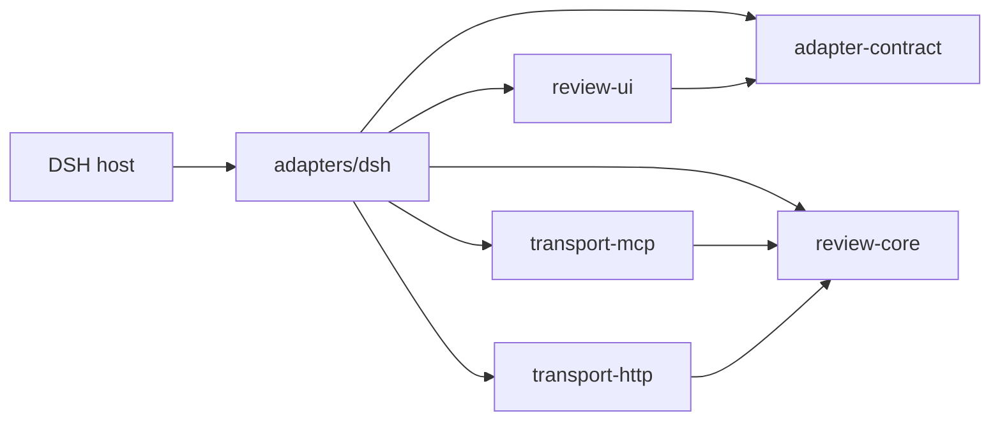

# 09 · CoSpace System Architecture

This page records the current architecture. The normative adapter contract is [14 · Adapter Integration Contract](14-adapter-integration.md).

## Current dependency direction

The dependency direction is inward from each adapter. The review core does not know which host is using it. DSH owns plugin registration, its resource URI, account lookup, conversation and workspace integration, service lifecycle, and product packaging. The core owns document and review semantics. Shared UI receives a neutral adapter context and does not inspect DSH SDK objects.

## Package responsibilities

| Package | Responsibility |
| --- | --- |
| `packages/review-core/` | Space service, local SQLite persistence, review transactions and domain errors |
| `packages/adapter-contract/` | Versioned host capability names, declaration validation, runtime capability intersection, TypeScript declarations |
| `packages/review-ui/` | Shared review surface; consumes the core API and optional adapter capabilities |
| `packages/transport-mcp/` | Host-independent MCP facade over core operations |
| `packages/transport-http/` | Host-independent HTTP handler over core operations |
| `adapters/dsh/` | DSH runtime composition, host bridge, capability declaration and distribution |
| `apps/review-web/` | Reserved for a possible local WebApp adapter; not implemented |

## Adapter removal record

WorkBuddy Connector was removed as an active product and adapter. Its implementation, build paths, website install flow, and current-product documentation are no longer part of the workspace. `docs/10-workbuddy-connector-development-plan.md` is retained only as a historical record and must not be treated as an implementation or release plan. Historical references do not participate in builds or runtime behavior.

The adapter contract uses a capability ceiling broad enough for a local WebApp reference implementation, but that implementation is not required by the core and is not currently being built. DSH declares only its supported host integration and degrades optional UI actions based on the resolved runtime capability set.

## Core boundary

Do not modify the behavior of `packages/review-core/src/review-core.js` without the explicit prior consent required by the repository guidelines. Adapter separation is implemented at the composition, transport, contract, and UI boundaries; core review semantics stay unchanged.
