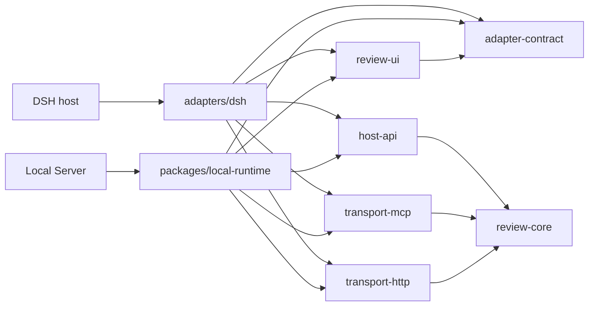

# 09 · CoSpace System Architecture

This page records the current architecture. The normative adapter contract is [14 · Adapter Integration Contract](14-adapter-integration.md).

## Current dependency direction

The dependency direction is inward from each product edge. The review core does not know which host is using it. DSH owns plugin registration, its resource URI, account lookup, conversation and workspace integration, service lifecycle, and plugin packaging. Local Server owns its CLI and packaging; the shared local runtime owns its daemon, HTTP/MCP services, and browser review UI. The core owns document and review semantics. Shared UI receives a neutral adapter context and does not inspect DSH SDK objects or transport implementations.

## Package responsibilities

| Package | Responsibility |
| --- | --- |
| `packages/review-core/` | Space service, local SQLite persistence, review transactions and domain errors |
| `packages/host-api/` | Shared service facade composed from review services and optional host callbacks |
| `packages/adapter-contract/` | Versioned host capability names, declaration validation, runtime capability intersection, TypeScript declarations |
| `packages/review-ui/` | Shared review surface; consumes the core API and optional adapter capabilities |
| `packages/transport-mcp/` | Host-independent MCP facade over core operations |
| `packages/transport-http/` | Host-independent HTTP handler over core operations |
| `adapters/dsh/` | DSH runtime composition, host bridge, capability declaration and distribution |
| `packages/local-runtime/` | Local daemon, lifecycle and endpoint protocol |
| `apps/local-server/` | Local Server CLI and npm distribution |
| `apps/site/` | Public installation site |
| `dist/` | Generated package builds and final platform release artifacts; never edit by hand |

## Adapter removal record

WorkBuddy Connector was removed as an active product and adapter. Its implementation, build paths, website install flow, and current-product documentation are no longer part of the workspace. `docs/10-workbuddy-connector-development-plan.md` is retained only as a historical record and must not be treated as an implementation or release plan. Historical references do not participate in builds or runtime behavior.

CoSpace Desktop has been removed from the active product. DSH declares its supported host integration and degrades optional UI actions based on the resolved runtime capability set.

## Core boundary

Do not modify the behavior of `packages/review-core/src/review-core.js` without the explicit prior consent required by the repository guidelines. Adapter separation is implemented at the composition, transport, contract, and UI boundaries; core review semantics stay unchanged.

## Local runtime protocol compatibility

The Local Server CLI, MCP proxy and daemon can run different package versions. `LOCAL_PROTOCOL_VERSION` in `packages/local-runtime/src/paths.js` is the single source for the endpoint health response, installed runtime marker and bundled package metadata. Clients require an exact protocol match before connecting; an absent or different version fails with `LOCAL_SERVER_PROTOCOL_MISMATCH` and requires the service to be stopped or upgraded before reconnecting. The status command can still report an incompatible service.

Increment the protocol version whenever an existing RPC, session, authentication, endpoint or response contract changes incompatibly, including removals or changes to error semantics. Additive operations may retain the version only when both old clients and new clients can safely operate with the other side; otherwise increment it or explicitly negotiate the capability. Exercise matching, older, newer and missing protocol versions and the shared MCP behavior before releasing. A version mismatch must never silently start a second daemon over the same data home.

Review data and collaboration preferences share `review.sqlite` within each product's own data home. Document deletion removes its document-specific preferences in the same transaction as its review data; global preferences remain. This storage change does not import the former `collaboration.sqlite`.
