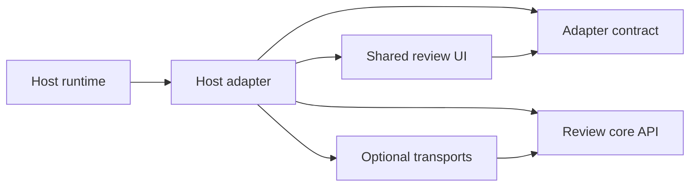

# 14 · Adapter Integration Contract

This document defines the supported boundary between CoSpace's host adapters, shared review UI, transports, and domain core. The Tauri Desktop app in `apps/desktop/` is the local product that exercises the widest capability set. It hosts the shared UI in a Tauri WebView and runs Node HTTP/MCP services as a managed sidecar. The DSH plugin in `adapters/dsh/` and Desktop app use the same adapter contract and declare only the host capabilities they provide. Product shells and their build scripts belong under `apps/<product>/`; host-specific integrations and plugin metadata belong under `adapters/<host>/`.

## Dependency direction



`packages/review-core` owns domain behavior and persistence. It must not import adapter code, adapter metadata, host SDKs, React, browser globals, host identifiers, or the adapter contract. An adapter constructs the core service, chooses storage and lifecycle, and exposes it through one or more transports. The UI depends on the neutral adapter contract for optional host integrations and calls the core through a transport API.

The contract package describes the boundary. It is not a service locator, plugin registry, or permission bypass. No central core switch such as `if (host === 'dsh')` is allowed.

## Core API and host capabilities are separate

The core API is the stable set of product operations: list and create documents, read content and review state, submit suggestions, decide suggestions, and manage comments. MCP, HTTP, and any future in-process transport expose the same domain semantics. Adding a host must not require changing `review-core.js` or adding host-specific branches to the core. `packages/host-api/` composes the shared service facade for DSH and Desktop; optional host callbacks are passed into it by the product edge.

Host capabilities are optional actions around those domain operations. The current contract registry is in `packages/adapter-contract/src/index.js` and the matching TypeScript declarations are in `packages/adapter-contract/src/index.d.ts`.

| Capability group | Examples | Typical full local WebApp implementation | DSH implementation |
| --- | --- | --- | --- |
| Conversation | read current, create/open conversation, send request, insert references | May expose all actions through its host bridge or local UI | Current session send/create/open and structured reference insertion where DSH exposes them |
| Workspace | list/select workspace | May expose all actions | Uses DSH workspace APIs when available |
| Identity | read current user | Optional local profile or host account | DSH account information when available; anonymous fallback otherwise |
| Navigation | open document, register deep links | Browser route and local links | DSH sidebar resource and plugin route |
| Files | choose import file, save export | Browser picker/download and any separately authorized local service | Browser-supported export; absent capabilities use a clear fallback |
| UI/runtime | notifications, lifecycle, windows, shortcuts, update events | Browser/local-service functions subject to permission | Only functions exposed by the plugin host |
| Local runtime | manage local service, choose storage location | Potentially available to a separately installed local process | Not assumed; DSH owns its plugin lifecycle and data path |

The “full local WebApp” column is a design ceiling, not a guarantee. A browser API may require a user gesture, permission, secure context, or a live local service. The adapter reports what is usable in the current session.

## Declaration and runtime negotiation

Each adapter owns an `adapter.json` beside its implementation. It declares stable support, not a promise that every operation is currently available. Dynamic state such as the active DSH conversation is passed separately as `conversation.current`:

```json
{
  "id": "dsh",
  "version": "0.1.0",
  "contractVersion": 1,
  "capabilities": [
    "conversation.current.read",
    "conversation.send",
    "conversation.references.insert",
    "identity.current.read",
    "navigation.document.open"
  ]
}
```

At startup or when host state changes, the adapter intersects its declaration with APIs available in the current host session using `resolveAdapterCapabilities(declaration, availableNow)`. The result contains both `declared` and `available`. Runtime state can remove a declared capability but cannot invent an undeclared one. Permission-dependent calls can still fail after negotiation; those failures must be returned with a stable error code and a recoverable UI message.

Unknown capability names and unsupported contract versions fail fast during adapter development/build. Unknown future optional fields can be ignored. A capability's absence means unavailable; adapters must not rely on optimistic defaults.

## Adapter bridge shape

The contract surface is intentionally capability-oriented and composed of optional, typed operations. The adapter passes one object to shared UI surfaces:

```js
{
  capabilities: resolvedCapabilities,
  core: { request(method, args, options) },
  conversation: {
    current, getCurrent(), create(options), open(id), send(request), insertReferences(items),
  },
  workspace: { list(), select(id) },
  identity: { getCurrentUser() },
  navigation: { openDocument(id), createDocumentLink(id), parseDocumentLink(address) },
  files: { chooseImport(options), saveExport(file) },
  clipboard: { writeText(text) },
  notifications: { show(message) },
  updates: { subscribe(listener) },
  lifecycle: { subscribe(listener) },
}
```

Groups and methods are optional. Their presence must agree with the negotiated capability set. `core.request` is the only required operation for the shared review UI; adapters can expose it through HTTP, an in-process transport, or another transport without changing UI domain behavior. Host methods are called only after checking the matching capability. Do not pass raw host contexts, filesystem handles, arbitrary command execution, credentials, or unrestricted service locators into shared UI.

The capability registry is versioned and uses stable names. A new optional capability can be added compatibly. Renaming/removing a capability or changing its semantics requires a new contract version and an adapter migration note. Capability names identify user-visible host functions, not low-level SDK method names.

## Graceful degradation

Shared UI checks `available` at the action boundary and presents the best supported route:

- No current conversation: offer create/open if declared; otherwise offer copy only when clipboard write is available.
- No identity: attribute a comment to the localized generic user label.
- No deep-link registration: keep document navigation inside the adapter's main view.
- No file save API: use a browser download only when available; otherwise explain that export cannot be saved here.
- No update subscription: retain bounded polling as the fallback.
- A capability disappears while the UI is open: handle the operation error, refresh the capability snapshot where supported, and leave document/review state intact.

Capability negotiation must not weaken core invariants. Suggestion decisions remain explicit user actions. No adapter may silently apply Agent suggestions, send comments without an explicit user action, or turn an unavailable host feature into a different write operation.

## DSH adapter mapping

`adapters/dsh/adapter.json` declares the DSH integration surface. `adapters/dsh/client/index.jsx` adapts DSH APIs into the neutral `adapter` value passed to `SpaceApp` and sidebar review surfaces. DSH-specific Cordis registration, `dsh-resource://` references, account lookup, session selection, workspace lookup, and opening the right sidebar stay under `adapters/dsh/`.

The shared UI receives `{ capabilities, conversation }` for optional conversation actions and a core API function for domain operations. It does not inspect DSH SDK objects, resource URI schemes, host names, or transport implementations. Adapters provide the request function; shared UI packages do not import HTTP or MCP transports directly. If DSH lacks a feature at runtime, the corresponding operation is omitted or disabled; current DSH document and review operations continue to use the shared service facade.

## Adding an adapter

1. Create `adapters/<id>/` with its own host entry points, package manifest, `adapter.json`, implementation, and focused host integration checks.
2. Select the shared core and transports it needs. Construct one core service per intended storage boundary and own its startup, shutdown, locking, and error reporting in the adapter.
3. Implement only the declared capabilities. Translate host APIs to the contract's input/output shapes at the adapter edge; do not copy review rules into the adapter.
4. Expose the core operations through a supported transport. HTTP services must bind only to an explicitly intended interface and apply origin/authentication protections; a loopback address alone is not authentication.
5. Pass the neutral bridge to shared UI. Confirm that every absent capability has an intentional fallback and that no host SDK or host identifier enters `packages/review-core` or generic transports.
6. Keep build, packaging, release metadata, and tests inside the adapter or a small adapter-owned script. Root scripts may call a declared product command but must not contain host-specific implementation branches.
7. Build and inspect the adapter artifact, then run shared checks and the target host's acceptance flow. Removing the adapter should remove its directory and product entry points without edits to the core or remaining adapter.

## Removal and boundary checks

An adapter is removable when its package/runtime directory, product entry point, and adapter-owned build/deployment files are removed. The shared core, contract, transports, and remaining adapters must not need behavioral changes. Historical design/acceptance records may mention a removed adapter when clearly labeled as historical.

Review changes against these invariants:

- No import edge from `packages/review-core` to `adapters/`, the host contract, UI, transports, or a host SDK.
- No host name, SDK object, host URI, or host environment variable in core domain code.
- No host-specific branch in the generic transport packages.
- Every shared UI host operation is optional and capability-gated.
- Each adapter owns its host registration, lifecycle, storage configuration, bridge implementation, and product packaging.
- The maximum capability reference implementation does not become a required dependency of other adapters.
