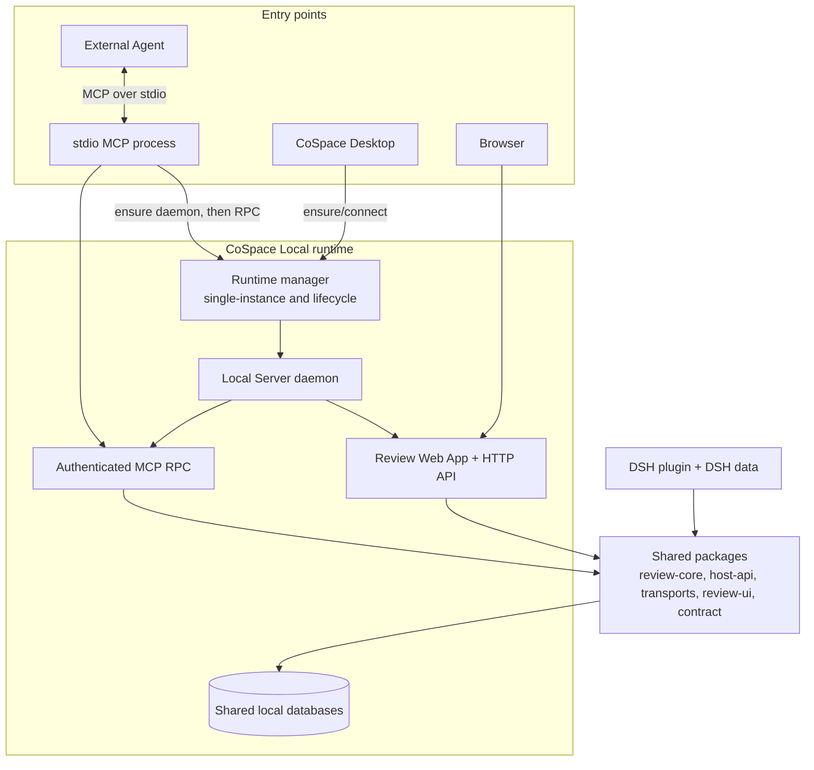

# CoSpace Local Server Design

> Historical planning record: Desktop has been removed; see current architecture and release documentation for supported products.

## Summary

CoSpace Local Server is the generic local runtime for stdio MCP Agents. It is shipped as a public npm package and can be launched with `npx`. A long-lived daemon owns the local database, HTTP APIs, and review web app. A stdio MCP process is a short-lived protocol client of that daemon. Desktop is another client and uses the same runtime and data. DSH remains a separate adapter and data boundary.



The diagram shows logical boundaries. The daemon is the only process that opens the database. MCP, Desktop, and browser requests reach it through bounded APIs.

## Repository layout

```text
packages/local-runtime/
  src/
    service.js             # Compose existing host API, HTTP handlers, MCP RPC
    daemon.js              # Start/stop the one service owner
    protocol.js            # Health and versioned local RPC contracts
    paths.js               # Shared data and runtime paths
    lifecycle/             # PID/lock validation and endpoint discovery
apps/local-server/
  bin/cospace-local.js     # CLI: mcp and service management modes
  src/mcp-entry.js         # Stdio transport; thin proxy to Local Server
  src/daemon-entry.js      # Packaged daemon entry
  scripts/build.mjs        # Bundle runtime and review web assets
  package.json             # Public npm package metadata, engines and bin
apps/desktop/
  ...                      # Tauri shell, desktop UX, Agent setup
```

`packages/local-runtime` owns host-neutral runtime behavior and may depend on existing shared packages. `apps/local-server` owns CLI, npm packaging, and release metadata. `apps/desktop` owns only Desktop UX, Tauri packaging, and Desktop-specific integration. No shared package may import from either app. DSH does not depend on `packages/local-runtime` for its initial implementation.

## Runtime and process ownership

### Processes

1. **stdio MCP client:** launched by the Agent using the npm package's `mcp` command. It owns only the stdio protocol connection and a local RPC client.
2. **Local Server daemon:** detached from the MCP process and independent of Desktop window lifetime. It owns one `SpaceService`, one `CollaborationStore`, one loopback HTTP listener, static UI serving, and database connections.
3. **Desktop client:** starts or discovers the same daemon, then renders its web UI in Tauri or a Desktop webview. It must not open the same SQLite files independently.

Desktop-only Agent discovery and MCP-config editing stay in `apps/desktop`. The generic daemon must not inherit filesystem permissions or routes for editing arbitrary Agent configuration. The current `/local/agents` Desktop HTTP route should move behind a Tauri command or a Desktop-owned bridge; the shared review API remains served by Local Server. The shared review UI receives the optional Desktop action through its adapter/props, while the generic web UI omits it.

First release does not install an OS login service. The daemon starts on first use and stays alive until explicitly stopped, system shutdown, or process failure. `service status`, `service open`, `service stop`, and `service restart` give users discoverable lifecycle controls. Desktop and MCP may call the same manager API.

### Local endpoints

- HTTP binds to `127.0.0.1` only. Use a loopback-assigned port and persist the actual endpoint in runtime metadata; `service open` and MCP tool results expose the current review URL.
- A runtime lock is created atomically. PID is only a hint: health response, process identity, runtime version, and protocol version must also be checked to avoid PID reuse and stale files.
- Browser routes serve static content and the existing bounded review HTTP API. A separate internal MCP RPC route has a strict operation allowlist and a local secret. It is not a generic `method,args` dispatcher exposed to browser pages.
- The daemon returns a versioned health document containing service version, protocol version, port, and readiness. Do not return secrets in health responses.
- Each stdio MCP process opens a short local lease and refreshes it while connected. Leases expire after 60 seconds without a heartbeat; graceful MCP shutdown closes its lease immediately. Service stop/restart is refused while a live MCP lease exists, so an upgrade cannot interrupt an active Agent connection.

### MCP composition

Reuse the tool schemas, instructions, and domain behavior in `packages/transport-mcp/server.js`. Add a narrow remote service facade that implements only the methods required by `createMcpServer` and forwards them to the daemon RPC. Do not create a second `SpaceService` in the stdio process. Keep MCP stdout protocol-only; diagnostics go to stderr or logs.

The MCP server should make the review URL discoverable after a document create/propose operation and through server instructions or a dedicated status tool. It must not automatically accept/reject suggestions. The web app remains the user decision surface.

## Data layout and compatibility

### Shared user data

For the first release, keep Desktop's current data home to prevent existing data from appearing to disappear:

```text
COSPACE_WEB_HOME, if configured
otherwise ~/.cospace/webapp/
  review.sqlite
  collaboration.sqlite
```

Runtime control files and versioned executable assets are separate from this data:

```text
platform app-data directory/cospace-local/
  runtime/                    # lock, endpoint metadata, token, logs
  versions/<package-version>/  # daemon bundle and web assets
  current-version.json
```

The resolver is implemented once in `packages/local-runtime` and consumed by Desktop and Local Server. Preserve `COSPACE_WEB_HOME` as an override for existing installs. DSH continues resolving `DSH_SPACE_HOME` / DSH-owned home and remains isolated.

### Ownership and multiple installations

- Multiple Agents using the same OS user and default profile share one daemon and one dataset.
- Desktop and generic Agent clients share that same daemon and dataset.
- Desktop-only Agent setup remains a Desktop feature and is not required for generic Local Server operation.
- DSH keeps its separate DSH-owned data and does not connect to Local Server.
- Separate OS accounts naturally have separate user data. Optional named profiles may be considered later, but are not in the first release.
- Lock and endpoint metadata are scoped by canonical data-home/profile, so an explicit `COSPACE_WEB_HOME` profile does not collide with the default profile.
- Uninstalling an npm package, Agent config, or Desktop removes its app/config files only. Data and runtime metadata are retained unless the user explicitly chooses data removal.

### Database and migrations

The daemon is the only database owner. Do not rely on several app processes independently opening the same SQLite files. At startup, migrations are versioned, transactional where possible, and preceded by a verified backup when they can alter or rebuild user data. Preserve the existing database schema and review semantics in the initial Local Server work; any behavior change to review-core requires separate explicit consent.

## npm packaging and updates

### Package contents

Publish one scoped package, `@hanfang5057/co-space`, with a single `cospace-local` binary. Include a bundled MCP entry, daemon entry, and web assets. Bundle workspace code and runtime dependencies into the artifacts where practical; only Node built-ins should be needed at daemon runtime. Declare `engines.node >=24` and verify the Agent's configured Node runtime actually satisfies it.

### Cache independence

`npx` can execute package code from npm's cache, which is not a durable install location. On first run, the CLI copies the daemon bundle and static web assets to an app-managed, versioned runtime directory and validates the completed copy before marking it current. The detached daemon starts from that managed directory, not from npm cache. User databases never live under the npm cache or versioned program directory.

### Upgrade policy

- Website-generated setup uses `npx -y @hanfang5057/co-space@latest mcp`; advanced users may pin `@X.Y.Z`.
- A running process is never overwritten in place. A newly launched MCP client compares package version and protocol version with the daemon.
- If the daemon protocol is compatible, clients connect and the MCP instructions report a newer package version when applicable. If the user requests an upgrade while clients are active, refuse to stop the daemon and explain that Agents must disconnect first. After clients drain, stage the new version, atomically activate it, gracefully restart, and health-check before reporting success.
- Retain at least the current and previous daemon bundles for rollback. Keep data untouched during code rollback.
- `service rollback [version]` selects an explicitly named installed bundle or the highest installed version older than the running daemon; it stops only after MCP leases drain and never rolls back user data.
- Database migrations must be backward-compatible with supported client protocol versions or explicitly block downgrade and provide restore guidance.
- Publish prereleases to `next`, stable releases to `latest`. Each npm version is immutable. Verify tarball contents, registry version, dist-tag, and provenance after publishing.

## Security

- Bind only to loopback; reject non-loopback Host values and unexpected Origin values. Do not enable broad CORS.
- Generate a cryptographically random local secret. Store it in a user-only runtime directory with restrictive permissions; never write it into Agent config or logs.
- Use separate browser-session and MCP-RPC authorization paths. The browser gets only its restricted UI API capability; internal RPC exposes only MCP operations.
- Limit request size, methods, content types, and timeouts. Avoid URL fetches, arbitrary file paths, and shell operations.
- Do not expose document content or comments in logs, health checks, or process arguments.
- A loopback address alone is not authentication. Treat unexpected Host/Origin, invalid token, stale endpoint, and port collision as explicit errors.

## Build, test, and release strategy

- Build Local Server artifacts from a clean commit; package only generated runtime bundles and web assets.
- `npm pack --dry-run` must show the expected files and exclude secrets, databases, source maps if not intended, and unrelated workspaces.
- Add focused tests for daemon single-instance/race behavior, stale metadata, concurrent MCP clients, RPC allowlists, authentication, cache independence, restart recovery, version mismatch, and data migration/retention.
- Verify existing Node checks in implementation. Add end-to-end manual acceptance on supported OS/Agent combinations for install via npx, MCP connection, proposal creation, Agent exit, browser review, Desktop shared data, restart, upgrade, rollback, and uninstall retention.
- Release only after package verification and clean-worktree checks. Use npm provenance when the public repository and CI publishing setup permit it.

## Decisions deferred until implementation spike

- Whether supported Agent environments can launch the required Node 24 runtime; keep a clear unsupported-runtime error and validate actual targets.
- Whether the loopback port should be reserved and stable or assigned dynamically per data-home profile. Initial design stores the selected port and offers `service open`.
- Whether the Local Server review page is opened automatically on first startup. Default recommendation: do not open a browser as a side effect of MCP connection; return and display the review URL instead.
- Desktop's exact Tauri-to-daemon launch mechanism and how packaged Node resources are reconciled with a newer npm-managed daemon. Require a runtime protocol compatibility check before sharing.
